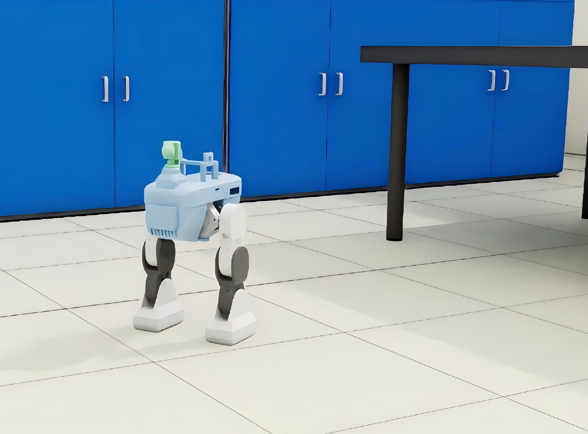
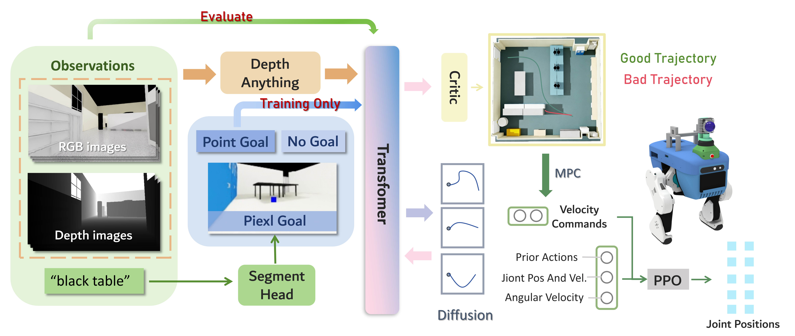
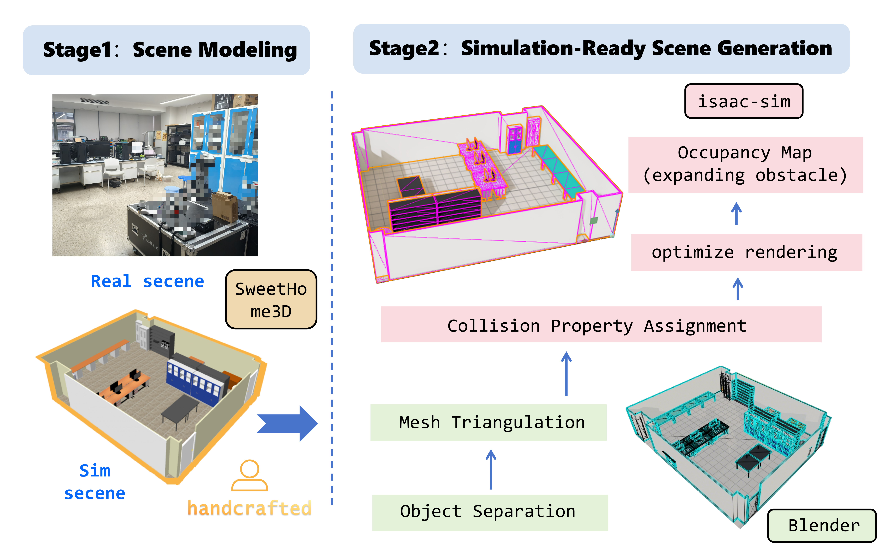
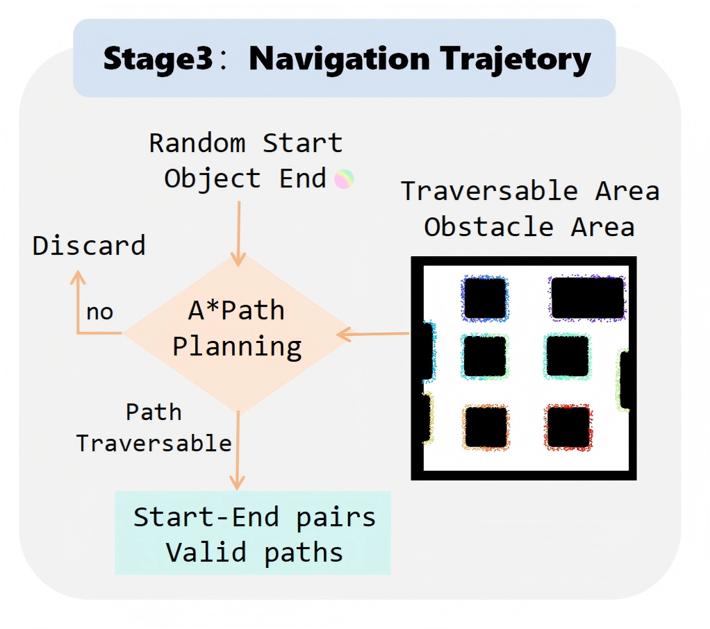
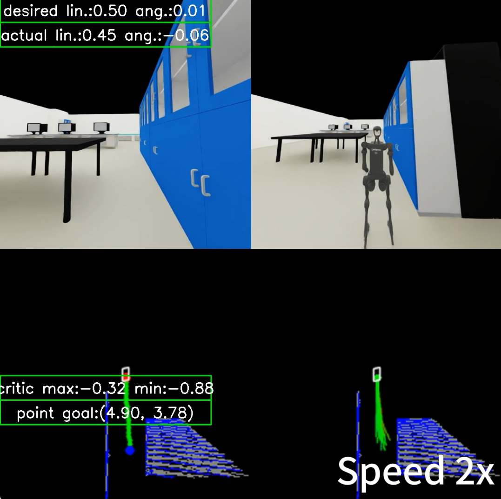
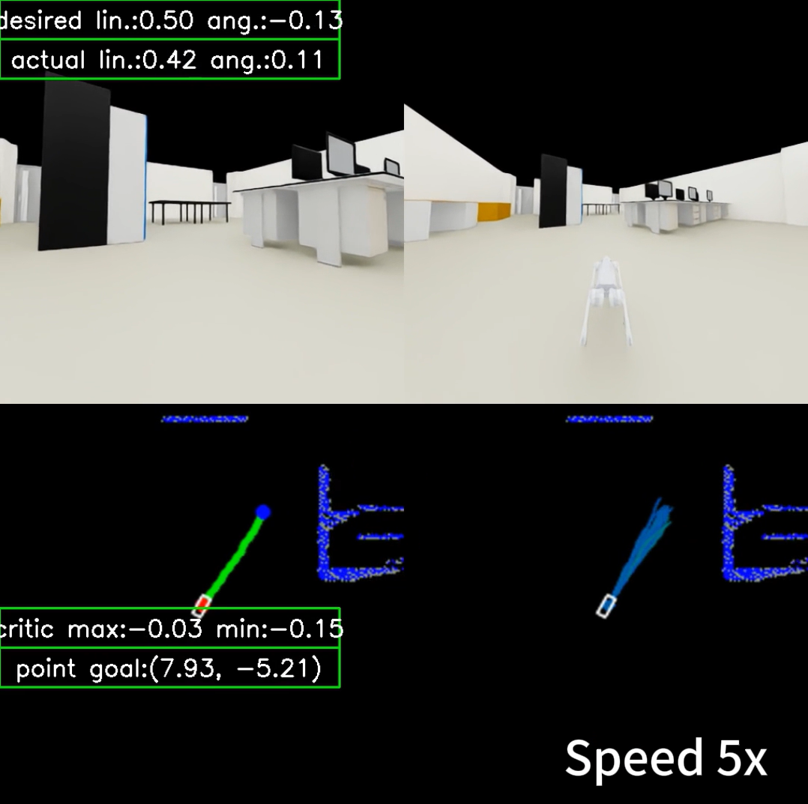
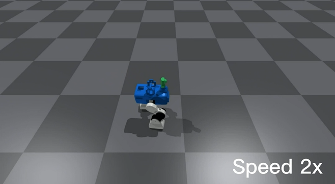
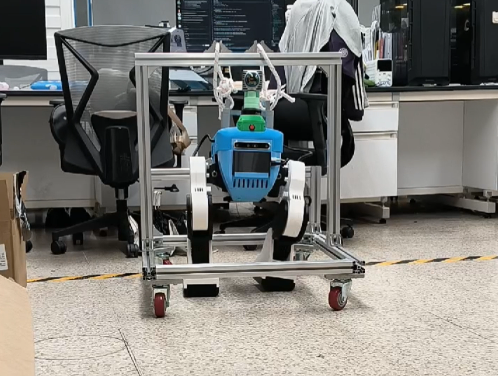

<h1 align="center">🤖 SKG-Nav</h1>

<p align="center">
  <strong>Semantic Knowledge-Guided Object-Goal Navigation<br>for Robots in Localized Scenes</strong>
</p>
<p align="center">面向本地化定制场景的语义知识引导机器人目标导航</p>

<p align="center">
  <strong>📄 已发表于 KSEM 2026 · CCF-C 类会议</strong><br>
  <sub>International Conference on Knowledge Science, Engineering and Management</sub>
</p>

<p align="center">
  <code>ObjectNav</code> · <code>Semantic Perception</code> · <code>Diffusion Planning</code> · <code>Bipedal Robot</code>
</p>

<p align="center">
  <a href="#overview">项目背景</a> ·
  <a href="#method">方法概览</a> ·
  <a href="#pipeline">数据流水线</a> ·
  <a href="#simulation">仿真展示</a> ·
  <a href="#hardware">真机平台</a> ·
  <a href="#stack">技术组成</a>
</p>

---

> **从语义目标到双足运动执行。** 将语义感知、扩散轨迹规划与机器人运动控制连接起来，探索适用于固定室内环境的分层导航方法。

<p align="center">
  
</p>
<p align="center"><em>双足机器人在 Isaac Sim 定制室内场景中的仿真画面。</em></p>

| 🎯 语义目标引导 | 🧭 分层导航规划 | 🦿 双足运动执行 |
| :---: | :---: | :---: |
| 从物体描述提取像素级目标 | 扩散模型生成轨迹，结合安全筛选 | 高层规划与底层运动策略衔接 |

<a id="overview"></a>

## 01 · 项目背景

Object-Goal Navigation（ObjectNav）要求机器人根据物体名称或语义描述，在环境中找到相应目标。实际部署中，实验室、办公室等空间往往相对固定，能够预先构建接近真实布局的仿真场景，并利用场景内数据学习导航行为。

SKG-Nav 围绕这一场景展开：通过定制场景生成训练数据，将语义目标转化为图像中的像素目标，再由高层规划器生成候选轨迹，结合轨迹筛选与底层策略完成运动执行。

<a id="method"></a>

## 02 · 方法概览

**语义目标 → 像素目标 → 候选轨迹 → 安全筛选 → 运动执行**

<p align="center">
  
</p>

| 模块 | 作用 |
| --- | --- |
| **语义目标感知** | 将物体语义与视觉观察关联，得到**像素级导航目标** |
| **多模态特征融合** | 融合 RGB、深度相关特征和目标条件，通过 **Transformer** 建模 |
| **扩散轨迹规划** | 使用条件扩散模型生成**多条候选未来轨迹** |
| **轨迹筛选** | 根据**安全性与可行性**评价候选轨迹，选择执行路径 |
| **底层运动执行** | 将高层轨迹转换为运动指令，由 **PPO 运动策略**输出关节控制 |

高层规划与底层控制采用分层设计，为替换不同机器人平台的运动策略提供接口。此处展示的实验平台为自研 10 自由度双足机器人；不将架构的适配设计等同于已完成多平台验证。

<a id="pipeline"></a>

## 03 · 场景与数据流水线

**SweetHome3D → Blender → Isaac Sim → 导航轨迹采集**

### 1. 从真实布局到仿真环境

使用 SweetHome3D 构建室内布局，在 Blender 中进行物体拆分、网格三角化和材质处理，再以 USD 格式导入 Isaac Sim，设置碰撞属性并完善渲染。

<p align="center">
  
</p>

### 2. 导航轨迹生成

在仿真环境中构建占据栅格，并结合机器人尺寸扩张障碍物区域。采样起点和目标物体附近的终点，通过 A* 搜索筛选可通行路径，为导航数据采集提供有效起终点与参考路径。

<p align="center">
  
</p>

采集的数据包含同步 **RGB 图像、深度信息及机器人运动序列**。

| 定制场景 | 每场景导航轨迹 | 轨迹总数 |
| :---: | :---: | :---: |
| **10** | **100** | **1,000** |

<a id="simulation"></a>

## 04 · 仿真展示

### 室内导航与轨迹可视化

下面两张截图展示了机器人在定制室内环境中的导航过程。上方分别为机器人视角与外部观察视角，下方展示场景障碍物、目标位置及规划轨迹，便于观察感知、规划与运动执行之间的关系。

<p align="center">
  
</p>
<p align="center"><em>导航示例一：桌椅与储物柜附近的导航画面，原演示标注为 2 倍速。</em></p>

<p align="center">
  
</p>
<p align="center"><em>导航示例二：办公桌布局中的导航画面，原演示标注为 5 倍速。</em></p>

<details>
<summary><strong>查看导航界面字段说明</strong></summary>

| 字段 | 含义 |
| --- | --- |
| `desired` / `actual` | 期望 / 实际的线速度与角速度 |
| `point goal` | 当前点目标坐标 |
| `critic` | 轨迹评价数值范围 |
| `Speed 2x` / `Speed 5x` | 原演示视频的播放倍率 |

这些信息用于观察运动跟踪和轨迹选择。

</details>

### 双足机器人运动仿真

<p align="center">
  
</p>
<p align="center"><em>自研双足机器人的底层运动仿真画面，原演示标注为 2 倍速。</em></p>

该示例展示机器人在平坦地面上的运动仿真，与上方室内导航示例分别呈现底层运动能力和导航过程。

<a id="hardware"></a>

## 05 · 真机平台

<p align="center">
  
</p>
<p align="center"><em>自研双足机器人真机，配备保护支架与悬挂绳索。</em></p>

真机照片展示了机器人的机身、双腿结构及实验室测试装置，与前述仿真模型对应。


<a id="stack"></a>

## 06 · 技术组成

| 方向 | 使用的方法与工具 |
| --- | --- |
| 场景构建与仿真 | SweetHome3D、Blender、USD、Isaac Sim |
| 语义感知 | 语义分割、像素目标表示、SegFormer |
| 高层规划 | Depth Anything、Transformer、条件扩散模型、DDPM |
| 数据生成 | 占据栅格、障碍物膨胀、A*、导航轨迹采样 |
| 运动控制 | 分层控制、PPO、双足机器人仿真 |

## 07 · 公开内容

<details>
<summary><strong>查看展示文件目录</strong></summary>

```text
SKG-nav/
├── README.md
└── assets/
    └── images/
        ├── robot-simulation.png
        ├── navigation-architecture.png
        ├── scene-pipeline.png
        ├── trajectory-generation.png
        ├── navigation-demo-01.png
        ├── navigation-demo-02.png
        ├── biped-locomotion-demo.png
        └── real-robot-platform.png
```

</details>

<p align="right"><a href="#">↑ 返回顶部</a></p>
