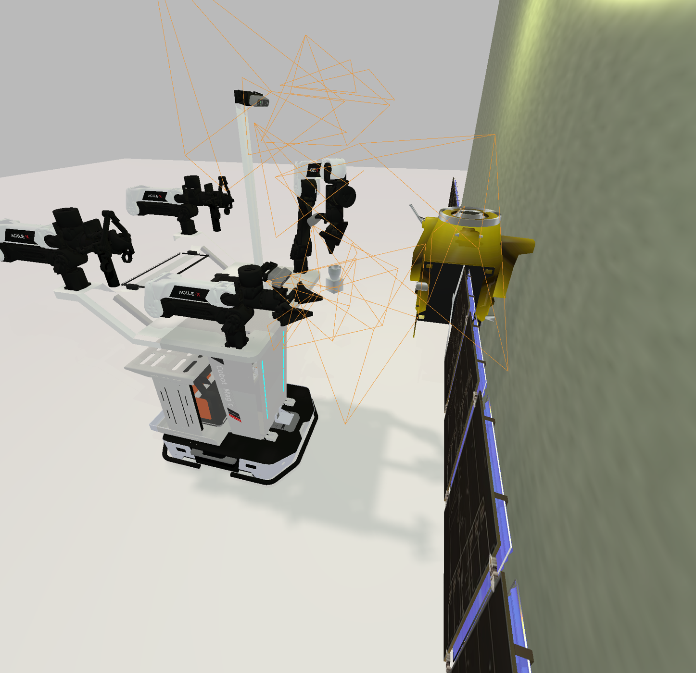
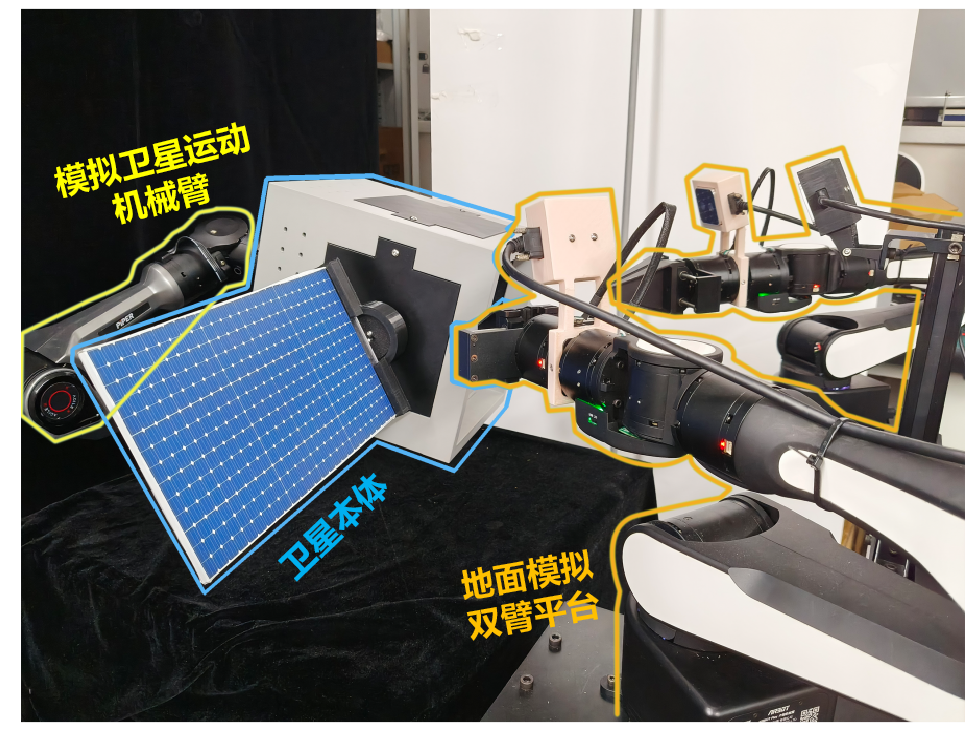

<h1 align="center">🤖 面向模块化设备自主更换的 VLA 双臂机器人</h1>

<p align="center"><strong>基于VLA的任务微调与自定义双臂操作场景适配</strong></p>

<p align="center">
  <strong>📄 CollaborateCom 2026 · CCF-C 类会议 已录用</strong><br>
  <sub>EAI International Conference on Collaborative Computing: Networking, Applications and Worksharing</sub>
</p>

<p align="center">
  <code>视觉—语言—动作模型</code> · <code>双臂协同操作</code> · <code>任务微调</code> · <code>模块化设备</code>
</p>

<p align="center">
  <a href="#overview">项目概述</a> ·
  <a href="#workflow">模型适配流程</a> ·
  <a href="#demo">任务演示</a> ·
  <a href="#scene">自定义场景</a> ·
  <a href="#engineering">工程重点</a> ·
  <a href="#scope">展示范围</a>
</p>

***

> **从通用操作策略到模块化设备任务。** 以 XR0 为基座模型，使用 RoboDojo-Sim 对应权重初始化，在 RoboTwin 任务上微调，再适配自定义模块化设备拆卸场景。

|       🧠 复用基座能力       |      🔧 面向任务微调     |  🦾 适配双臂场景  |
| :-------------------: | :----------------: | :---------: |
| 基于XR0-RoboDojo-Sim 权重 | 在 RoboTwin 中开展任务适配 |   面向双臂协作任务  |
|   基于XR0-Pre-train 权重  |    在**真机**开展任务适配   | 面向自定义双臂协作任务 |

<a id="overview"></a>

## 01 · 项目概述

模块化设备的维护需要机器人理解操作目标，并结合视觉观察和自身状态执行操作。本项目围绕**模块化设备自主更换**这一目标，使用视觉—语言—动作（VLA）模型连接任务指令与双臂动作。

项目采用**已有模型能力复用 → 仿真任务微调 → 自定义场景适配**的技术路线。当前展示围绕模块拆卸场景展开，重点呈现模型微调与场景应用之间的工程链路。

**“自主更换”是项目的应用目标，本文具体展示范围为模块拆卸场景适配。**

<a id="workflow"></a>

## 02 · 模型适配流程


| 阶段        | 项目中的作用                           |
| --------- | -------------------------------- |
| **基座模型**  | 以 **XR0** 作为视觉—语言—动作策略基础         |
| **权重初始化** | 使用 **RoboDojo-Sim 对应权重**作为任务微调起点 |
| **任务微调**  | 在 **RoboTwin** 任务中进行策略微调         |
| **场景适配**  | 将微调后的策略用于自定义模块化设备拆卸场景            |

**模型基座、初始化权重与项目微调承担不同角色。** 本项目的展示重点是已有模型的任务适配和场景应用；模型原有结构与能力归属于相应开源工作。


<a id="demo"></a>

### 🎬 XR0 微调后任务演示

**以下视频展示 XR0 微调后策略在 RoboTwin 的 `stack_bowls_three` 任务中的执行过程。**

https://github.com/user-attachments/assets/076616a9-a677-43d6-8149-7df60927ce2d


<a id="scene"></a>

## 03 · 自定义模块化设备场景

### 🖥️ 仿真环境

仿真场景包含机器人操作平台、设备装配体与目标操作区域，用于模块拆卸任务的场景构建与策略适配。任务设计结合**设备结构、目标模块位置与机器人可达空间**组织操作过程。

<p align="center">
  
</p>
<p align="center"><em>仿真环境：机器人与设备模型的场景搭建画面</em></p>

### 🦾 真实环境

真实环境由**双臂操作平台、设备实验件与实验台**组成，展示面向模块拆卸任务搭建的硬件布局与操作空间。

<p align="center">
  
</p>
<p align="center"><em>真实环境：实验室双臂操作平台及设备实验装置。</em></p>

两组图片分别展示**仿真场景构建**与**真实硬件平台**；XR0 微调后的任务执行示例见上方视频。

<a id="engineering"></a>

## 04 · 工程重点

| 方向                | 展示重点                                 |
| ----------------- | ------------------------------------ |
| **模型与权重衔接**       | 说明 XR0 基座、RoboDojo-Sim 权重与微调后策略之间的关系 |
| **RoboTwin 任务微调** | 梳理任务数据与训练流程，明确训练任务及配置                |
| **场景接口适配**        | 连接自定义环境的视觉观察、机器人状态与策略动作              |
| **双臂任务组织**        | 将模块拆卸目标落到机器人操作流程中                    |
| **执行验证**          | 分别记录仿真任务执行、真实平台搭建和真机策略验证情况           |

<a id="scope"></a>

## 05 · 展示范围

> **当前版本展示项目思路、模型适配路线、XR0 微调后任务视频、仿真场景与真实硬件平台。**

<details>
<summary><strong>查看当前展示文件</strong></summary>

```text
dual-arm/
├── README.md
└── assets/
    ├── images/
    │   ├── simulation-scene.png
    │   └── real-robot-platform.png
    └── videos/
        └── xr0-finetuned-task.mp4
```

</details>

<p align="right"><a href="#">↑ 返回顶部</a></p>
